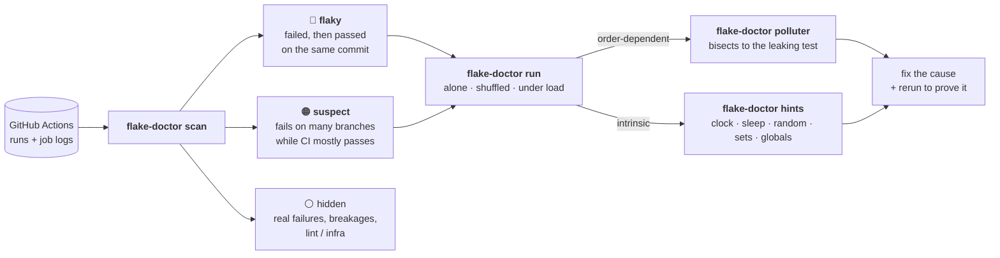

<div align="center">

# 🩺 flake-doctor

**Find the flaky tests hiding in your CI history.<br>Then prove what causes them, and that the fix works.**

[](https://pypi.org/project/flake-doctor/)
[](https://github.com/marketplace/actions/flake-doctor-flaky-test-report)
[](https://github.com/ChiragPatankar/flake-doctor/actions/workflows/ci.yml)
[](LICENSE)




<sub>A real scan of aiohttp's last 30 days of CI, replayed. Numbers and messages are from the actual run.</sub>

[**Quick start**](#-quick-start) · [**How it works**](#-how-it-works) · [**Real results**](#-results-on-real-projects) · [**Diagnose a test**](#-diagnose-one-test-locally) · [**FAQ**](#-faq)

</div>

---

Every team with CI has tests that fail for no reason. Someone clicks **Re-run**, it goes green, and the flaky
test lives on to waste the next person's afternoon. Nobody keeps a list of which tests do this, but **your CI
history already does**: every time a job *failed and then passed on the same commit*, a test flaked.

flake-doctor reads that history, tells you which pytest tests are flaky and what they cost you, then helps you
diagnose and fix each one with evidence instead of `sleep()` and retries.

> [!TIP]
> Try it on any public repo. You only need a GitHub token that can read it:
> `flake-doctor scan pydantic/pydantic`

## 🚀 Quick start

<details open>
<summary><b>Command line</b>: scan any repo you can read</summary>
<br>

```bash
pipx install flake-doctor        # or: pip install flake-doctor, or run it without installing: uvx flake-doctor
export GITHUB_TOKEN=...                                            # or `gh auth login`, or ~/.config/flake-doctor/token
flake-doctor scan owner/repo                                       # or run it inside a clone and omit owner/repo
```

| Option | What it does |
|--------|--------------|
| `--days 60` | how far back to look (default 30) |
| `--workflow tests` | only workflows whose name or file matches |
| `--branch main` | only runs on one branch |
| `--format markdown\|json`, `--output FILE` | report format and destination (`--json-output`/`--markdown-output` for extra copies) |
| `--max-logs 400` | download budget; logs that can *prove* flakiness are read first |
| `--scan-passing` | also read passing logs, to catch tests pytest-rerunfailures quietly retried |
| `--all` | also list failures that look real rather than flaky |
| `--fail-on-flaky` | exit 1 if anything flaky is found (for CI gates) |

Job logs are cached in `~/.cache/flake-doctor`, so a repeat scan only downloads what's new.

To run scans and reruns on GitHub's machines instead of your own, fork this repo and use the
**Scan a repo** workflow (Actions tab → *Scan a repo* → *Run workflow*); see
[`scan-repo.yml`](.github/workflows/scan-repo.yml) for the one secret it needs.

</details>

<details>
<summary><b>GitHub Action</b>: a "Flaky test report" issue that updates itself</summary>
<br>

```yaml
# .github/workflows/flaky-tests.yml
name: Flaky test report
on:
  schedule:
    - cron: "0 6 * * 1"     # every Monday
  workflow_dispatch:

permissions:
  actions: read
  issues: write

jobs:
  scan:
    runs-on: ubuntu-latest
    steps:
      - uses: ChiragPatankar/flake-doctor@v0
        with:
          days: 30
          workflow: tests     # optional: only your test workflow(s)
```

The report also goes to the job summary. Outputs: `flaky-count`, `suspect-count`, `report` (JSON path).
Set `fail-on-flaky: true` to fail the job when flaky tests are found, or `create-issue: false` to skip the issue.

</details>

<details>
<summary><b>Claude Code plugin</b>: let Claude find, fix and verify them</summary>
<br>

```
/plugin marketplace add ChiragPatankar/flake-doctor
/plugin install flake-doctor@flake-doctor
```

Then ask things like *"CI keeps going red, which tests are flaky?"* or *"test_checkout fails on CI but never
locally, fix it."* The skill scans the CI history, measures before touching code, finds the mechanism (with a
deterministic reproduction where it can), fixes the cause rather than adding retries, and reruns enough times
to make "it passed" mean something.

</details>

## 🔍 How it works



| Verdict | Evidence required |
|---------|-------------------|
| 🔴 **flaky** | the same job (workflow + job name + matrix) **passed on the same commit** after the test failed, or **pytest-rerunfailures** had to retry it |
| 🟠 **suspect** | failed on **3+ commits across 2+ branches**, *and* the workflow passed at least half its runs around those failures |
| ⚪ **hidden** | anything else: failures on one branch (probably a real bug), failures while CI was red everywhere (a breakage, e.g. a new dependency release), and failed jobs with no pytest failures at all |

> [!NOTE]
> That last rule matters. On fastapi, 4 tests failed on 20 commits across 12 branches, which looks flaky at first
> glance. But the workflow passed only 13% of runs around those failures: a dependency release had broken
> everything. flake-doctor keeps those out of the flaky list.

## 📊 Results on real projects

30 days of GitHub Actions history (19 Sep to 19 Oct 2026), default settings:

| Project | Runs scanned | Failed jobs | Flaky tests | What they were |
|---------|-------------:|------------:|------------:|----------------|
| [pydantic](https://github.com/pydantic/pydantic) | 1,241 | 1,144 | **7** | 4 date tests that fail whenever CI runs across midnight UTC, plus 3 in third-party suites it runs |
| [aiohttp](https://github.com/aio-libs/aiohttp) | 4,180 <sub>(25 days)</sub> | 610 | **7** | keep-alive and read timeouts hitting connection resets, a WebSocket heartbeat test, a timing assertion |
| [fastapi](https://github.com/fastapi/fastapi) | 3,119 | 257 | 0 | correctly *not* flagged: 6 tests failing on many branches were a dependency breakage and a red-CI period |
| [pandas](https://github.com/pandas-dev/pandas) | 2,836 <sub>(7 days)</sub> | 500 | 0 | the jobs that passed on retry failed for infrastructure reasons (HTTP 500s, build errors) |

<details>
<summary><b>The pydantic bug: a test that only fails after midnight</b></summary>
<br>

In `tests/test_datetime.py`, `date.today()` is evaluated inside `@pytest.mark.parametrize`, which runs when
tests are **collected**, not when they run (simplified):

```python
@pytest.mark.parametrize('value', (date.today(), date.today() + timedelta(1), '2064-06-01'))
def test_past_date_validation_fails(value, past_date_type):
    with pytest.raises(ValidationError):   # "today" must not count as a past date
        ...
```

A macOS job collected tests on 10 October and ran them after midnight UTC. By then "today" was yesterday,
so `PastDate` accepted it:

```
value = datetime.date(2026, 10, 10)
E       Failed: DID NOT RAISE ValidationError
```

The re-run passed 50 minutes later. It's the kind of failure nobody investigates, because it only ever happens
to someone else's job, late at night.

</details>

<details>
<summary><b>Most red CI isn't flaky tests</b></summary>
<br>

Across these four projects, the large majority of failed jobs were lint, type checks, docs builds, bots and
infrastructure. flake-doctor reports those separately ("failed jobs without pytest failures" and "jobs that
failed and then passed on the same commit") so they don't drown out the tests.

A first 30-day scan of a busy repository takes a few minutes and about 1,000 API requests, mostly log
downloads. Repeat scans reuse the cache and take 20 to 90 requests.

</details>

## 🧪 Diagnose one test locally

Once you know *which* test is flaky, find out *why*. Real output from
[`examples/warehouse`](examples/warehouse), a 176-test project with a buried bug:

```console
$ flake-doctor run "tests/test_checkout.py::test_order_total[standard]"

Isolated runs: 0/10 failed (0%)

Shuffled-suite runs: 13/20 failed (65%)
   13x  AssertionError: assert 104.29 == 129.11
  tests that change the outcome when they run before it:
    +1.00  tests/test_promotions.py::test_flash_sale_price[WID-100S-20]  (failed 13/13 when before, 0/7 when after)

Verdict: ORDER-DEPENDENT
  Passes alone but fails in some suite orders: another test leaks state into it.
  Next: flake-doctor polluter 'tests/test_checkout.py::test_order_total[standard]' --seed 868885 --scope tests
```

One parametrized promotions test mutates a dict returned by an `lru_cache`, silently repricing the product for
every later test (and, in production, for every later customer).

| Command | What you get |
|---------|--------------|
| `flake-doctor run <test>` | failure rate alone and in shuffled suite order, grouped failure messages, tests that correlate with failure, a verdict, and how many clean runs it takes to trust a fix. `--stress` loads every CPU core like a crowded CI runner; `--json` saves before/after results. |
| `flake-doctor polluter <test> --seed N` | the exact test that breaks it when run first, plus a two-test reproduction command |
| `flake-doctor hints <test>` | suspicious lines in the test and the code it imports: sleeps, real clocks, unseeded randomness, set/filesystem ordering, unrestored globals and env vars, network calls, fixed ports and paths |

> [!IMPORTANT]
> The local commands run *your project's* interpreter (auto-detecting `.venv`/`venv`, or `--python`), switch
> off plugins that hide or distort flakiness while measuring (pytest-randomly's ordering, rerunfailures, xdist,
> pytest-cov), and never modify your files.

[`causes.md`](plugins/flake-doctor/skills/flake-doctor/references/causes.md) is a practical guide to each kind of
flakiness, the right fix, and the "fixes" that only hide it.

## ❓ FAQ

<details>
<summary><b>Do I need a token? What can it access?</b></summary>
<br>

GitHub requires authentication to download job logs, even for public repos. Read access to the repository's
Actions is enough; Issues write is only needed for `--issue`. Without a token, `scan` still lists the *jobs*
that failed and then passed on the same commit, which needs no logs.

</details>

<details>
<summary><b>Is my code or data sent anywhere?</b></summary>
<br>

No. flake-doctor only talks to the GitHub API, and only reads (except `--issue`, which writes one issue).
Your token is never forwarded to the storage host GitHub redirects log downloads to, and logs are cached
locally in `~/.cache/flake-doctor`.

</details>

<details>
<summary><b>Which test frameworks and CI systems are supported?</b></summary>
<br>

pytest on GitHub Actions. Test names come from pytest's `FAILED`/`ERROR` summary, xdist progress lines, `-v`
output, pytest-pretty's failure table, or pytest's own failure sections, so it works whatever summary plugin you
use. Retries are attributed to tests from `RERUN` lines (needs `-v` or `-rR`). The job-level report works
for any language.

</details>

<details>
<summary><b>My project never re-runs jobs. Will it find anything?</b></summary>
<br>

Fewer confirmed flakes, yes. Push and pull-request runs of the same commit still count as a same-commit pass,
and "suspects" still surface. Logs expire after 90 days by default, so very old failures can't be attributed.

</details>

<details>
<summary><b>Why not just add retries?</b></summary>
<br>

Retries make the symptom rarer and leave the cause in place. Sometimes the cause is a real bug: the pydantic
test above is fine, but the warehouse example's polluter would charge real customers the wrong price.
flake-doctor helps you find the cause and prove it's fixed.

</details>

<details>
<summary><b>How much does a scan cost in API requests?</b></summary>
<br>

About one request per 100 runs, one per failed or re-run run, and one per job log read. Big test matrices can
fail dozens of jobs at once, so logs are budgeted (`--max-logs`): jobs with a same-commit pass first, then at
most two matrix siblings per run, newest first.

</details>

<details>
<summary><b>Does the Claude Code skill actually help? (benchmarks)</b></summary>
<br>

`evals/` holds the benchmark: realistic requests run by Claude with and without the skill against
[`examples/flaky-zoo`](examples/flaky-zoo) and the harder [`examples/warehouse`](examples/warehouse), graded by
scripts that rerun each fixed test 60 to 200 times and check the product code directly.

The honest result: on small, readable codebases a strong model fixes these flakes without the skill too. The
skill made verification more rigorous (fixes checked with 50+ reruns: 3/3 with the skill vs 1/3 without), but
the outcome-changing part is **finding** flaky tests in the first place, which needs CI history no model can
see by reading code. That's why `scan` is the core of this project.

</details>

## 🗺️ Roadmap

- [x] PyPI release and GitHub Marketplace listing
- [ ] JUnit XML artifacts as an alternative to log parsing
- [ ] Jest/Vitest and Go test output
- [ ] GitLab CI
- [ ] PR comments when a failure matches a known flaky test

## 🤝 Contributing

Issues and PRs welcome, especially CI log excerpts the parser gets wrong. See [CONTRIBUTING.md](CONTRIBUTING.md),
and [docs/DESIGN.md](docs/DESIGN.md) for how it works and why each detection rule exists.

Read more: [*I scanned a month of CI from pydantic, aiohttp, fastapi and pandas for flaky tests*](docs/blog/2026-10-flaky-tests-in-popular-python-projects.md).

## License

[MIT](LICENSE)
